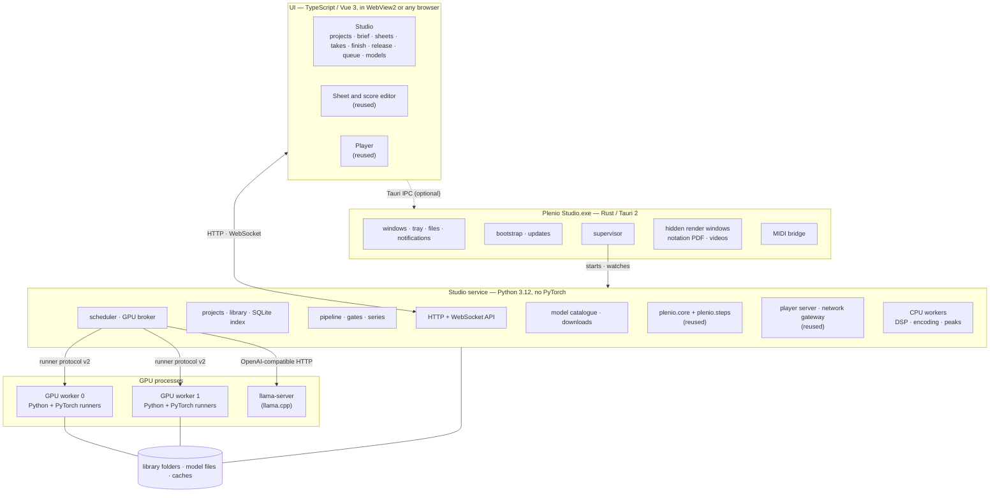
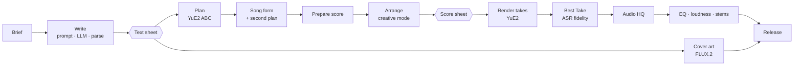

# Plenio Studio — Plenio as a standalone application (concept)

| | |
|---|---|
| Status | **Concept for the owner's decision — nothing is implemented** |
| Date | 2026-10-25 |
| Request | "Build this tool with all its functions as a real standalone application that makes the songs (MiniMax left out) and plays them, locally and completely independent of ComfyUI. Analyse how to do it best, choose the most suitable technology (Rust is an option), and write an extensive concept." (owner, 2026-10-25) |
| Basis | this repository at `87cfef7` (1.2.1 + sparse vocals); the ComfyUI v0.42.0-46 source, read for the inference Plenio uses today (YuE2, SheetSage2, FLUX.2, quantization); the YuE2 checkpoint header on the owner's machine; the installed runtime (Python 3.12.9, PyTorch 2.9.1 + CUDA 13.0, diffusers 0.36, transformers 5.5.4, CTranslate2 4.8.2); the owner's hardware (Windows 11, 2 × RTX 5060 Ti 16 GB with compute capability 12.0, 62 GB RAM) |
| Companion documents | [target-architecture.md](target-architecture.md) (the ComfyUI architecture this concept builds on), [yue2-design.md](yue2-design.md), [yue2-cover-design.md](yue2-cover-design.md), [player.md](player.md), [testing-strategy.md](testing-strategy.md) |

Evidence tags as in the other design documents: **[VF]** verified for this concept (code, files or measurements read), **[UP]** upstream documentation, **[EA]** engineering assessment, **[AS]** assumption to validate (collected in §15.2, most of them in the first phase).

---

## 0. Summary

**What.** *Plenio Studio* is one desktop application with two halves: the **Studio**, which makes songs (new songs, covers, composed songs, mastering of a recording), and the **Player**, which plays them, at home and in the home network. It runs YuE2 and every other model itself. ComfyUI is neither installed nor started, and none of its code is used. MiniMax Music 3 is left out.

**The central finding.** Plenio is already about two thirds independent of ComfyUI [VF]:

- `plenio.core` (30 461 lines) imports nothing from ComfyUI, and a test enforces it (R10).
- The Player has had a server of its own since 1.0.
- The score editor talks to the backend through 22 HTTP routes, and to ComfyUI's frontend through one small adapter (`shared/comfy.ts`).
- The ASR and LLM work already runs in worker processes.

ComfyUI contributes three things, and the concept replaces exactly these:

1. **Inference** for four model families (YuE2, SheetSage2, FLUX.2 Klein and the native writer), together with its GPU memory management and quantized kernels.
2. **The graph as orchestration**: caching, lazy branches, loops, the queue, review stops and progress.
3. **The canvas UI**: widgets, App mode, dialogs and the template browser.

**Recommended stack.**

| Layer | Technology | Why |
|---|---|---|
| UI | TypeScript + Vue 3: the score/sheet editor and the Player as they are, plus a new **Studio** shell | 34 000 lines are reused. Notation (abcjs), WebGL visuals, WebCodecs videos and the Player for phones in the network are all web technology. |
| Desktop host | **Rust + Tauri 2** | A small, safe native shell: windows, tray, files, notifications, the first-run installation of the runtime, updates, supervision of every process, a MIDI fallback, hidden render windows (notation PDF, videos). |
| Studio service | **Python 3.12, without PyTorch** | `plenio.core` unchanged, plus a new project, pipeline, scheduler and API layer. The 1 700 core tests and the aiohttp route handlers are reused. |
| Model runners | **Python + PyTorch** (CUDA), one GPU worker per GPU; **llama.cpp** (`llama-server`) for the writer | Every model Plenio uses has its reference implementation in PyTorch, so parity and new models come fastest. A separate process frees VRAM reliably when it ends. |
| Data | one folder per song project, a SQLite index, a content-addressed artefact store; the release record (`plenio.release/1`) stays the exchange format | Readable files, robust storage, today's songs keep working. |

**Why not Rust everywhere.** The critical path is inference parity, and that ecosystem is PyTorch. A pure Rust stack would first have to port seven model families to candle or ONNX Runtime, about 30–46 weeks [EA], before the first song sounds the way it does today. It would have to repeat that for every new model. The domain core would be rewritten (30 000 lines and 1 700 tests) without any gain the user can hear. Rust is used where it is strongest: the host, the supervisor, installation and updates, and native bridges.

Rust also has a planned path to grow. A **native runner** (candle, ONNX Runtime or llama.cpp) can replace a Python runner model by model behind the same runner protocol, once a measurement shows that it pays off. YuE2 is the first candidate, because its transformers are Qwen3-shaped (§11.6).

**What it gains over the ComfyUI version:**

- **Song projects instead of graphs.** You continue a song, compare its takes and keep its history.
- **Both GPUs at once.** The next song of a series is written and planned while the current one renders.
- **A review inbox.**
- **Background runs from the tray.**
- **A model manager** with downloads and licences.
- **Crash isolation** for each model.
- **The Studio in a browser on another device.**

**What it gives up:** free graph editing for power users. The ComfyUI package can stay as the power-user edition on the same core (D-S03).

**Effort** (§13.3, at this repository's pace [EA]):

- **MVP** (new songs with review, takes, Best Take, master, export, Player) in about **3–4 months**.
- **The whole feature set** (covers, composing, creative modes, cover art, stems and HQ, installer, migration) in about **5–7 months**.

**Decisions needed:** §14.

---

## 1. Goals, non-goals and constraints

### 1.1 Goals

| ID | Goal |
|---|---|
| G1 | **Everything the YuE2 templates do today.** That covers *1 · YuE2 · Song*, *2 · YuE2 · Cover*, *5 · YuE2 · DAW*, *4 · Enhance & Master*, *0 · System Check* and the Plenio Player. §2.1 lists every function. |
| G2 | **No ComfyUI.** Nothing of ComfyUI is installed, started, imported or copied. Model files in ComfyUI's folders may be used where they are, without copying. |
| G3 | **The same quality.** The same documents give results of the same kind. Plenio's checks stay the same: budgets, song form, lyrics fidelity, Check Vocals, the Song Sheet rules R4/R5. |
| G4 | **The same speed or better**, and both GPUs at the same time. |
| G5 | **A UI made for songs.** Projects, steps, documents, takes and releases instead of nodes and wires. |
| G6 | **Unattended long series.** For example 100 songs overnight, with no leak, no hang, and resuming after a crash or reboot. |
| G7 | **Local, offline, private.** No telemetry, no account, no cloud. The network is used only for model and update downloads the user starts. |
| G8 | **Continuity.** Exported songs, the Player's state, user templates and creative modes keep working, and a song made in ComfyUI can be continued. |

### 1.2 Non-goals

- **MiniMax Music 3 and MiniMax H3.** `core.engines.minimax` stays in the core for the ComfyUI package if that is kept (D-S03), but the Studio does not offer it.
- **A general node editor.** Workflows are fixed, typed recipes with options (§7.3), not user-wired graphs.
- **Cloud features, collaboration, and accounts** beyond the Player's existing login.
- **Model training or fine-tuning.**
- **Mobile apps.** Phones use the Player in the browser, as today.
- **Re-rendering takes from the ComfyUI version bit for bit** (§13.1). Their documents carry over exactly; new takes are made by the new runners.

### 1.3 Constraints

| ID | Constraint | Consequence |
|---|---|---|
| C1 | **Plenio is Apache-2.0** (ADR-0002); ComfyUI is GPL-3.0 | Inference code comes from upstream sources or permissive libraries, never from ComfyUI (rule R10 continues). YuE2's upstream is Apache-2.0: ComfyUI's own file says "Adapted from M·A·P YuE2 (Apache-2.0)" [VF `comfy/ldm/yue2/model.py`]. SheetSage2's code licence must be checked [AS-S4]. |
| C2 | **Weights keep their own licences** (YuE2 and SheetSage2 CC BY-NC 4.0, UniverSR CC BY 4.0, FLUX.2 Klein 4B Apache-2.0, … [VF `resources/models.toml`]) | Weights are never shipped. The user downloads them with the licence shown and accepted, or points the Studio at files already on disk. |
| C3 | **Reference hardware**: 16 GB of VRAM per GPU, sm_120 (Blackwell), Windows 11 | Every GPU stage must fit 16 GB. Two GPUs are an advantage, not a requirement. |
| C4 | **English UI and documentation** (ADR-0008) | German can come later (D-S12). |
| C5 | **Windows first** | Linux second, macOS only with a measured Apple GPU path (D-S02). |
| C6 | **Small team** (the owner with AI assistance) | Few languages, few dependencies, strong tests, and no rewrite for its own sake. |

---

## 2. What Plenio is today

### 2.1 Function inventory

| Area | Functions | Today | In the Studio |
|---|---|---|---|
| **Briefs** | Song Brief: the work mode (*new song every run* / *one song, stop to review*), template, description, genre, mood, tempo, length 1:00–6:00, vocals *sung*/*sparse vocals*/*instrumental* (language, voice, theme or melody and lead instrument), key, meter, creative mode, genre closeness, lines under the singing, creativity 0–100, lyrics fidelity. Cover Brief: *original lyrics*/*new lyrics*/*instrumental*, harmony, title, song flow closeness, lyrics closeness, phrasing reference. 239 templates, user templates, choice hints | `core.brief`, `core.creativity`, `core.fidelity`, `core.series`; the brief nodes | **Reuse** the core; a brief form in the Studio (§10.3) |
| **Writing** | Writer choice (native Gemma 4, GGUF files, LM Studio, Ollama, llama.cpp, vLLM, Jan), prompt composition per engine, draft parsing and repair, ten titles with a random pick, artwork prompt, series angles | `core.writing`, `core.llm`; ComfyUI's `TextGenerate` for the default writer | **Reuse**. The default writer becomes a GGUF model in `llama-server` (§9.7); native `TextGenerate` goes away |
| **Song Sheets** | Documents *auto*/*edited*/*manual*, conflicts, review gates, series rules, budgets, live re-validation in the editor | `core.sheet`, the sheet node, the editor | **Reuse**. Gates become project states (§7.4) |
| **Score** | YuE2 plan (ABC), Match Song Form (second plan, fill thin sections), Score Tools (*prepare from brief*, *fit length*, split long sections), creative modes (compose → writer → apply), arrangement seed | `core.score` (8 857 lines), `core.song_form`, `core.preparation`, `core.arrangement` (4 366) | **Reuse**. The plan comes from the YuE2 runner |
| **Score editor** | Notation, piano roll, ABC text, playback with instrument sounds, chord lane, bar inspector, arranging sections and bars, cursor and paste, MIDI import, export and keyboard recording, MusicXML, the Guide track, notation export (PDF/PNG/SVG), sung pitch and source audio in covers | `frontend/src/sheet-editor` (11 725 lines) + routes | **Reuse** as a page of the Studio (§10.3.4) |
| **Render** | YuE2 Render and Takes, retakes started only when the lyrics fidelity asks for them, Best Take (ASR score), Check Vocals for instrumentals, render ceiling, the instrumental LoRA adapter | Native YuE2 nodes + `core` | **YuE2 runner** + stages (§7, §9.2) |
| **Covers** | Load and trim the source, Transcribe Score (SheetSage2), Sung Pitch (vocal stem + pitch), Transcribe Lyrics (Qwen3-ASR + ForcedAligner, Whisper fallback, stem or mix by confidence), Fix Misheard Words (writer), placement into the score's sections, Fit Lyrics (new lyrics on the melody, two repair rounds) | `core.asr`, `core.alignment`, `core.heard_check`, `core.lyrics_fit`, workers, native SheetSage2 | **Runners** (sheetsage2, msst, asr) + the core |
| **Finish** | Audio HQ (Stereo Cleanup, Regenerate Highs with UniverSR, DeReverb, Mastering), EQ with genre presets and a curve, loudness, Refine, Stems (BS-RoFormer 4-stem + residual mixer, stems as MIDI) | `core.audio` (3 238 lines), `third_party/msst`, `third_party/universr` | **Reuse**. DSP in CPU workers, models in runners |
| **Cover art** | FLUX.2 Klein 4B from the artwork prompt | Native ComfyUI nodes | **flux2 runner** (§9.6) |
| **Export** | Release: FLAC/WAV/MP3, tags with variables, cover, subtitles *(lines)*/*(notes)*/*(sung)* heard on the vocal stem, the record embedded in the FLAC, sheet music PDF drawn by the browser | `comfy/nodes/export.py` (1 009 lines), `core.release`, `core.subtitles`, `comfy/sheet_music.py` | **Move to the shared steps** (§5.4). The PDF comes from a hidden render window (§11.4) |
| **Continuity** | *Continue a Plenio song* (record or FLAC), seeds 🔒/🎲 with the follow mode, System Check, model catalogue | core + ComfyUI extension | **Native in the project model**; Diagnostics and Models pages |
| **Player** | Library (folders, other music), search, filters, tags, a song page (documents, sheet music following the music, lyrics as written or sung), now playing, the visuals (the classics and the Plenio Drop presets), playlists and queue, Live Play with guests, videos (WebCodecs → MP4), shared players (portable HTML, in parts), network gateway, login and accounts, settings | `plenio/player` (5 309 lines) + `frontend/src/player` (20 561) | **Reuse unchanged**; *Open in ComfyUI* becomes *Open in Studio* |

### 2.2 What ComfyUI does for Plenio today

| ComfyUI provides | Plenio uses it for | Replacement in the Studio |
|---|---|---|
| YuE2: `YuE2GenerateABC`, `YuE2GenerateMusic`, `EmptyYuE2LatentAudio`, `KSampler`, `CFGGuider`, `SamplerCustomAdvanced`, `VAEDecodeAudio`, `CheckpointLoaderSimple`, `LoraLoader` [VF templates] | Plan, render, retakes, the instrumental adapter | **yue2 runner** (§9.2) |
| SheetSage2: `AudioEncoderLoader`, `SheetSage2AudioToABC`, plus Plenio's calls into `comfy.audio_encoders.sheetsage2_abc` [VF `comfy/host.py`] | Cover score, Check Vocals | **sheetsage2 runner**, ported from upstream (§9.3) |
| `TextGenerate` + `CLIPLoader` (Gemma 4 E4B in ComfyUI's format) | The default writer | **llama-server** with a GGUF, or a local app (§9.7). `core.llm` already exists (ADR-0010) |
| FLUX.2: `UNETLoader`, `CLIPLoader`, `Flux2Scheduler`, `EmptyFlux2LatentImage`, `VAEDecode` | Cover art | **flux2 runner** with diffusers (§9.6) |
| Quantized kernels (comfy-kitchen, Apache-2.0: int8, convrot, mxfp8 layouts), dynamic VRAM, weight prefetch, CUDA-graph capture [VF `comfy/quant_ops.py`, `comfy/text_encoders/yue2.py`] | YuE2 at 4 GB and at speed on 16 GB | The runner memory manager: bf16 or fp8 in PyTorch, CUDA graphs. Optionally comfy-kitchen to read existing int8 files (§9.2.3) |
| Model management (load, unload, offload, `free_memory`, interrupt, progress) | Every model stage | Residency in the GPU workers + the GPU broker (§8) |
| `folder_paths` (model folders, output folder) | Model lookup, export folder | Model catalogue + library paths (§12.1) |
| Graph execution: output cache, lazy switches, loops, batch count, WebSocket progress, UI payloads | The templates as orchestration | **Pipeline + scheduler + events** (§7, §8, §10.1) |
| The frontend: canvas, App mode, widgets, DOM widgets, dialogs, toasts, settings, template browser, missing-model dialog, File menu | Every user interaction outside the editor and the Player | **Studio UI** (§10) |
| aiohttp server for the `/plenio/*` routes | Editor and extension backend | **Studio service API**, with the same handlers (§10.1) |

### 2.3 What can be kept

| Asset | Size [VF] | In the Studio |
|---|---|---|
| `plenio/core` | 87 files, 30 461 lines | **unchanged**: briefs, writing, engines (YuE2 rules), score, arrangement, sheet, song form, lyrics, alignment, ASR, subtitles, release, audio DSP, LLM client, assets, models catalogue |
| `plenio/player` | 16 files, 5 309 lines | **unchanged**, plus small additions (*Open in Studio*, service integration) |
| `plenio/workers`, `plenio/core/workers` | 962 lines | the basis of runner protocol v2 (§9.1) |
| `plenio/third_party` | 4 865 lines (YuE `abc_tools`, MSST/BS-RoFormer, Qwen3-ASR inference, UniverSR) | **unchanged**, inside the runners |
| `plenio/comfy` | 42 files, 9 552 lines | not used by the Studio. About 40–60 % of it is logic (export, host services, HQ, briefs, arrangement) that moves to a shared layer first (§5.4) [EA] |
| `frontend/src/player`, `sheet-editor`, `shared` | 20 561 + 11 725 + 2 195 lines | **reused**. `shared/comfy.ts` becomes a platform adapter with a ComfyUI and a Studio implementation |
| `frontend/src/extension` | 4 146 lines | ComfyUI-only. Its ideas (review queue, run status, continue a song, seeds follow mode, EQ widget) are rebuilt in the Studio |
| Tests | 112 Python test files: 1 718 unit and workflow tests, 32 contract tests, 169 host tests; 74 TypeScript test files with 546 tests | The unit and TypeScript tests stay. The host tests are replaced by service tests with fake runners (§12.4) |
| Resources and schemas | templates, arrangement modes, presets, `models.toml`, `record-1`, `report-1` and `sheet_state-1` schemas | **unchanged**, extended by `plenio.project/1` (§6.3) |

---

## 3. The hard part: inference without ComfyUI

### 3.1 YuE2 as it runs today [VF]

YuE2 is not one network but three parts, run in four phases:

| Part | Shape | Phases |
|---|---|---|
| **Language model** (ComfyUI calls it the "text encoder") | Qwen3-style decoder: 28 layers, hidden 2 048, 16 query and 8 key/value heads of 128, MLP 6 144, vocabulary 184 704, context 24 576 tokens. The tokenizer JSON is stored inside the checkpoint. | **Plan**: ABC tokens (vocabulary below EOD 151 643), up to 8 192, T 0.7, top-p 0.9, top-k 30, repetition 1.005 over 100 tokens [UP yue2-design §1]. **Semantic**: codec tokens (32 768 codes from 151 853) at **25 per second of music**, CFG against a negative prefix when the scale is not 1, repetition penalty over the last 50 tokens, at least 200 tokens; the budget is the context minus the prompt. |
| **Acoustic transformer** | The same shape, with a timestep embedding, 64 ↔ 2 048 projections and learned positions; a flow model | **Acoustic**: per chunk of (24 576 − prefix − 3) / 2 frames, it reads the language model's per-layer keys and values for the prefix and that chunk's semantic tokens, and refines 64-channel latents at 25 frames/s in **32 steps** (`dpm_2`, `sgm_uniform`, CFG 1). |
| **VAE** | Oobleck-type decoder, 64 channels, strides 2·2·4·4·5·6 = 1 920, 48 kHz stereo [VF `comfy/sd.py`] | **Decode** (tiled). |

The owner's checkpoint `yue2_3b_int8_convrot.safetensors` (3.96 GB) holds 456 language-model, 464 acoustic and 435 VAE tensors. Its metadata says `source: m-a-p/YuE2-3B`, `vae_source: YuE2-Vae`, `quantization: convrot_int8` and `license: CC-BY-NC-4.0` [VF header]. The bf16 file is 7.8 GB.

ComfyUI makes it fast with three techniques [VF `comfy/text_encoders/yue2.py`]:

- static key/value buffers;
- a CUDA-graph capture of each decode step;
- reading the sampled tokens back to the host only every 16 steps.

It makes it fit with "dynamic VRAM": weights are prefetched layer by layer.

**Memory per phase** [EA from the shapes above]:

- **Keys and values**: 2 × 28 layers × 8 heads × 128 × 2 bytes = **112 KiB per token** and branch. A full context is **2.6 GiB**, or 5.3 GiB with CFG (two branches).
- **Weights in bf16**: language model ≈ 2.2 B parameters ≈ 4.4 GB; acoustic ≈ 1.45 B ≈ 2.9 GB; VAE ≈ 0.3 GB.
- **Fit on 16 GB**: bf16 fits when the semantic and acoustic phases do not need their peaks at the same time. int8 or fp8 halves the weights.

**Where the time goes** [EA]:

- **The token loop dominates.** Decoding is bound by memory bandwidth (448 GB/s on the 5060 Ti), so every token reads all language-model weights. That gives an upper bound of about 100 tokens/s in bf16 and about 200 in 8-bit.
- **A 3-minute song** needs up to about 8 000 plan tokens and 4 500 semantic tokens.
- **The acoustic phase** is compute-bound but short: 32 passes over about 4 500 frames.

So a standalone YuE2 must have a token loop as fast as ComfyUI's: static cache, graph capture, and 8-bit weights where quality allows (AS-S1, AS-S2).

### 3.2 The other models

| Model | Task in Plenio | Size | Weights | Code today | Standalone runtime |
|---|---|---|---|---|---|
| **SheetSage2** (MERT-v2 ConvNeXt/Conformer encoder + event decoder with a grammar + ABC rebuild) | Cover score, Check Vocals | 1.39 GB | CC BY-NC 4.0 | ComfyUI native, "adapted from m-a-p/SheetSage2" [VF] | **sheetsage2 runner**, ported from upstream [AS-S4]. Peak 16.5–17.0 GiB on the 16 GB card in ComfyUI, with offloading [VF phase 4A report] |
| **Qwen3-ASR 1.7B + Qwen3-ForcedAligner 0.6B** | Lyrics ASR and word times | 3.8 + 1.7 GB | Apache-2.0 | `plenio/third_party/qwen3_asr` in a worker | **reuse** |
| **faster-whisper large-v3** (CTranslate2) | ASR fallback | 2.9 GB | MIT | Worker (`plenio/workers/asr.py`) | **reuse** |
| **BS-RoFormer 4-stem** | Stems, the vocal stem for ASR, sung pitch | 0.53 GB | MIT (trainer), MUSDB18-HQ terms | `plenio/third_party/msst` | **reuse** |
| **UniverSR** | HQ 2 *Regenerate Highs*, Refine | 0.23 GB | CC BY 4.0, MIT code | `plenio/third_party/universr` | **reuse** |
| **FLUX.2 Klein 4B** + Qwen3-4B text encoder + VAE | Cover art | 7.8 + 8.0 + 0.3 GB (fp8 4.1, fp4 encoder 3.8) | Apache-2.0 | ComfyUI native | **flux2 runner** with diffusers. 0.36 has `Flux2Pipeline`, `Flux2Transformer2DModel` and `AutoencoderKLFlux2` [VF installed]; Klein support [AS-S5] |
| **Gemma 4 E4B** (writer; also arrangement, misheard check, Fit Lyrics) | Text | GGUF Q8 ≈ 5 GB | Apache-2.0 per the catalogue | `TextGenerate` (default) or the Local LLM node | **llama-server** (bundled) or LM Studio / Ollama (`core.llm`) |

### 3.3 Consequences

1. **Inference parity is the critical path, and it lives in PyTorch.**
   - Every model above has a PyTorch reference.
   - Four already run in Plenio's own PyTorch code (BS-RoFormer, UniverSR, Qwen3-ASR, ForcedAligner).
   - YuE2 and SheetSage2 have Apache-licensed upstream code [AS-S4 for SheetSage2].
   - FLUX.2 has diffusers.
2. **Only the writer has a mature native (non-Python) runtime.** That is llama.cpp, which Plenio already drives.
3. **Everything else in Plenio is model-independent**, and already independent of ComfyUI.
4. **The models Plenio will want next** (new YuE versions, new ASR, new separation) will also arrive in PyTorch first. The runner layer must make adding a model a matter of days, not months.

---

## 4. Technology analysis

### 4.1 Criteria

| Criterion | Weight | Meaning |
|---|---|---|
| Independence from ComfyUI | gate | No ComfyUI code, process or installation |
| Time to parity | 25 % | Until the Studio does what the templates do, at the same quality |
| Quality risk | 20 % | How likely the results are to sound worse |
| Maintainability and new models | 20 % | Effort to keep up with upstream and to add models; number of languages and dependencies |
| Robustness and desktop UX | 15 % | Crash isolation, unattended runs, installation, updates, native integration |
| Performance | 10 % | Render time, GPU use, UI responsiveness |
| Size and installation | 10 % | Download size, first-run reliability |

### 4.2 Inference runtimes

| Runtime | Windows + CUDA sm_120 | Covers Plenio's models | Quantization | Speed techniques | Effort per model | Verdict |
|---|---|---|---|---|---|---|
| **PyTorch 2.9** (eager, CUDA graphs, `torch.compile`) | runs today on the owner's machine (cu130, sm_120 [VF]) | all: upstream code, diffusers, Plenio's own | bf16, fp8 (`torch._scaled_mm` on Blackwell), int8 via torchao or comfy-kitchen | SDPA/flash attention, CUDA graphs, Triton (3.5.1 installed [VF]) | none to small: the reference is the implementation | **use for every runner in 1.0** |
| **candle** (Rust, Hugging Face) | CUDA backend (cudarc); kernels must be built for sm_120 [AS] | LLM-style transformers, Whisper, FLUX.1, EnCodec; YuE2's blocks are Qwen3-shaped. No Oobleck, MERT, BS-RoFormer, UniverSR, Qwen3-ASR or FLUX.2 | GGUF k-quants and q8_0 matmuls, bf16; fp8 limited [EA] | flash-attn v2 crate; no CUDA graphs [EA] | port and verify each model (§4.2.1) | **later**, per runner, YuE2 first (§11.6) |
| **Burn** (Rust, CubeCL) | CUDA, ROCm and wgpu backends | few pretrained models; everything would be ported | evolving | evolving | port | not now |
| **ONNX Runtime** via `ort` (Rust) or Python, CUDA/TensorRT execution providers | yes (TensorRT for Blackwell [AS]) | needs one ONNX export per model; autoregressive loops with a KV cache need care (prefill and decode graphs) | fp16, int8, fp8 with TensorRT | TensorRT fusion; engines built per GPU | export and verify each model | **later** for fixed-shape models (VAE, BS-RoFormer, MERT encoder) |
| **llama.cpp / ggml** | CUDA builds for Windows; `llama-server` already used by Plenio [VF ADR-0010] | the writer LLMs. Not YuE2's acoustic phase, which needs the per-layer keys and values | GGUF quantization | mature | none | **use for the writer** |
| **CTranslate2** | CUDA 12, installed [VF] | faster-whisper | int8, fp16 | mature | none | **use for the Whisper fallback** |
| **tch-rs** (libtorch from Rust) | needs libtorch (≈ 2–3 GB) | TorchScript or AOTInductor exports | as PyTorch | as PyTorch | export per model, with no benefit over Python | no |
| **PyTorch AOTInductor** (compiled models without Python) | [AS] | a later way to run PyTorch models from Rust or C++ | as PyTorch | as PyTorch | export per model | watch (§11.6) |

#### 4.2.1 What a native (Rust) inference stack would cost [EA]

| Model | Port work | Estimate (one experienced developer, with verification against PyTorch) |
|---|---|---|
| YuE2 | Qwen3 blocks exist; the acoustic transformer with external KV, the samplers and CFG, the flow solver, the Oobleck decoder (conv1d, snake activation, weight norm), the chunking | 6–10 weeks |
| SheetSage2 | ConvNeXt/Conformer encoder, decoder with grammar states, sliding windows, the ABC rebuild (the rebuild is plain code: it can stay in Python) | 6–9 weeks |
| BS-RoFormer | band split, rotary transformers, STFT/iSTFT on the GPU | 4–6 weeks |
| UniverSR | flow-matching network | 3–5 weeks |
| Qwen3-ASR + ForcedAligner | audio encoder + Qwen3 decoder; alignment head | 5–8 weeks |
| FLUX.2 Klein | DiT, Qwen3-4B encoder, new VAE | 6–8 weeks |
| **Total** | before the first song sounds as it does today | **30–46 weeks**, again for every new model, plus tuning to reach PyTorch's speed (graphs, fused attention, 8-bit matmuls) |

### 4.3 Desktop shell and UI

| Option | Reuses the 34 000 UI lines | Web features (WebGL2, WebCodecs, Web MIDI, AudioWorklet) | Size | Security | Updates, processes | Verdict |
|---|---|---|---|---|---|---|
| **Tauri 2** (Rust + system webview) | yes | Windows: WebView2 is Chromium, the same engine as Edge, which the Player's videos already require [AS-S6 for Web MIDI and WebCodecs inside WebView2]. Linux/macOS (WebKit): no Web MIDI, WebCodecs only in part → native fallbacks | ≈ 10–20 MB app | capability-based IPC, no Node in the UI | updater plugin with signatures, sidecar processes, single instance, tray, deep links | **recommended** |
| **Electron** | yes | Chromium everywhere | ≈ 150–250 MB | Node in the main process; more surface | mature | second choice; heavier for no gain on Windows |
| **Qt (PySide6 + QtWebEngine)** | yes, inside a web view | Chromium everywhere | ≈ 200 MB + Qt licensing (LGPL) | Python supervising Python | self-built | no |
| **Native Rust GUI** (egui, iced, Slint, Dioxus native) | **no**: notation, piano roll, visuals and videos would be rewritten | — | small | good | good | no |
| **Browser only** (a local server, the UI in Edge or Chrome) | yes | as the browser | none | as today | no tray, no file associations, no updater | kept as **remote mode** (§10.6), not the main app |

The Player must stay a web app anyway: guests and phones in the network open it in their browser. That settles web technology for the UI. On top of it the Studio gets a native host.

### 4.4 The domain core: keep Python or rewrite it?

**Keep it, in Python.** It is 30 000 lines with 1 700 tests, typed (`mypy --strict` on `core` and `player` [VF pyproject]) and free of heavy dependencies (numpy, scipy, PyAV, Pillow). It already has the shape a standalone service needs.

A rewrite in Rust would buy speed where none is needed: documents, prompts, ABC and DSP all run in seconds. It would cost months, and it would bring regressions in places only the owner's ear finds. It would also split the ComfyUI and Studio editions into two codebases.

**Targeted Rust later** (§11.6): the score kernel (`core.score` analysis and editing) compiled to WebAssembly, so the editor analyses and edits without a round trip to the service. Only if measurements show that the round trip hurts.

### 4.5 Shipping a Python runtime

| Option | Verdict |
|---|---|
| **uv + python-build-standalone**: the host installs a pinned Python 3.12 and two environments from hashed lock files, on first run or from an offline bundle | **recommended**: fast (Rust-based), reproducible, per user, no admin rights |
| PyInstaller or Nuitka (frozen app) | freezing PyTorch with CUDA is fragile and huge; every update ships everything again |
| conda / conda-pack | heavy; channel terms; slower |
| Docker | no GPU on Windows without WSL2; not a desktop app |
| Embedded Python in the host (PyO3, one process) | no crash isolation; the GIL; PyTorch in the UI process. **No** |

### 4.6 Architecture options compared

- **A — headless ComfyUI inside the app**: the app starts a hidden ComfyUI and sends graphs. Fastest parity, but **fails the gate** (G2, C1). It also inherits ComfyUI's update churn (the frontend restore defect, `TextGenerate` changes). It would only be useful as a development-time **oracle** for parity tests (§12.4).
- **B — Rust host + Python service + PyTorch runners + Vue UI** (recommended).
- **C — Rust host and a Rust domain core, Python only for the runners**: like B, but `plenio.core` rewritten in Rust.
- **D — pure Rust/native**: Rust host, Rust core, candle/ort/llama.cpp runners.
- **E — Python desktop**: PySide6 or Electron with a Python backend, no Rust.

| Criterion (weight) | A | **B** | C | D | E |
|---|---|---|---|---|---|
| Independence (gate) | ✗ | ✓ | ✓ | ✓ | ✓ |
| Time to parity (25 %) | 5 | **4** | 2 | 1 | 4 |
| Quality risk, higher is safer (20 %) | 5 | **4** | 4 | 2 | 4 |
| Maintainability and new models (20 %) | 2 | **4** | 3 | 2 | 3 |
| Robustness and desktop UX (15 %) | 3 | **4** | 5 | 5 | 3 |
| Performance (10 %) | 4 | **4** | 4 | 3 | 4 |
| Size and installation (10 %) | 2 | **2.5** | 2.5 | 4 | 2 |
| **Weighted** | — | **3.85** | 3.30 | 2.55 | 3.45 |

**Recommendation: B.** It keeps everything that works, puts each language where its ecosystem is strongest, and keeps a measured path toward more Rust (§11.6).

### 4.7 Where Rust is used, and what it buys

| Rust component | Why Rust |
|---|---|
| The **host** (Tauri 2) | A native window around the web UI; tray and background mode; file associations (`.plenio.json`, FLAC with a record, project folders); drag and drop; notifications; single instance; deep links (`plenio://`). |
| **Bootstrap** | Installs Python and the environments before any Python can run. Checks the GPU and driver, disk space and long-path support; repairs a broken environment. |
| **Supervisor** | Starts, watches and restarts the service and, through it, the GPU workers. Clean shutdown, log rotation, crash capture. It must stay up when Python crashes, so it must not be Python. |
| **Updater** | Signed updates of the app and of the service package; the runtime is re-synced when its lock file changes. |
| **Render windows** | Hidden webviews that draw notation PDFs and Player videos for background jobs (§11.4). |
| **MIDI bridge** | `midir` delivers a MIDI keyboard's notes to the editor where the webview has no Web MIDI (Linux, macOS; Windows as a fallback). |
| **Later: native runners** | candle, ort or llama.cpp runners behind the same protocol, once they are measured to be better (§11.6). |

---

## 5. Target architecture

### 5.1 Overview



The UI talks only to the service. The host's native features are optional enhancements, detected at run time, so the same UI also runs in a plain browser (§10.6).

### 5.2 Processes

| Process | Language | Lifetime | Responsibilities | Talks to |
|---|---|---|---|---|
| `Plenio Studio.exe` (host) | Rust (Tauri 2) | the app session; the tray keeps it alive | windows, bootstrap, supervision, updates, MIDI bridge, render windows, notifications, file associations | the service (stdio + HTTP), the UI (Tauri IPC) |
| **Studio service** (`python -m plenio.studio`) | Python 3.12, numpy/scipy/PyAV/Pillow/aiohttp/tokenizers, **no PyTorch** | as long as the host runs; restarted on a crash | API, projects and library, pipeline, scheduler, model catalogue and downloads, the player server and network gateway, the CPU worker pool | the UI, GPU workers, `llama-server`, the file system |
| **GPU worker** *n* (`python -m plenio.runners --gpu n`) | Python + PyTorch (CUDA) | started on demand, recycled after a configurable number of jobs or on fragmentation | loads runner modules (yue2, sheetsage2, msst, universr, asr, flux2), keeps models resident within a VRAM budget, executes operations | the service (runner protocol v2) |
| `llama-server` | C++ (llama.cpp CUDA build) | per writer call, or kept warm during a series | the writer LLM (chat completions) | the service (HTTP on loopback) |
| **CPU workers** | Python (process pool) | a pool owned by the service | mastering DSP, encoding (PyAV), waveform peaks, packaging | the service |
| **UI** | TypeScript / Vue | while a window or a browser tab is open | Studio, editor, Player | the service; the host when present |

A crash in a GPU worker costs that worker's job only. The service marks the job *failed (worker crashed)* with the worker's last log lines and starts a fresh worker. Because the worker process ends, all of its VRAM is freed. The service itself never imports PyTorch, so it is small (≈ 100–200 MB of RAM), starts in a second or two [EA] and has nothing that can exhaust GPU memory.

### 5.3 Repository

One monorepo, so that the core never forks:

```text
plenio/
  core/            unchanged: the pure domain library (+ tests/unit)
  steps/           new: the shared steps both front ends call (§5.4)
  studio/          new: the Studio service
    api/           aiohttp app: REST + WebSocket, the editor's routes, auth
    projects/      project store, artefact store, SQLite index, migration
    pipeline/      stages, recipes, cache keys, gates, series
    scheduler/     resources, GPU broker, placement, job journal
    catalogue/     model catalogue, downloads, verification, licences
  runners/         new: runner protocol v2, GPU worker, runner modules
    yue2/  sheetsage2/  msst/  universr/  asr/  flux2/
  player/          unchanged (+ "Open in Studio")
  comfy/           the ComfyUI front end (kept or frozen, D-S03; MiniMax lives only here)
  third_party/     unchanged
host/              new: Rust workspace (Tauri app + crates, §11)
frontend/src/
  studio/          new: the Studio shell and pages
  sheet-editor/    reused
  player/          reused
  shared/          reused; comfy.ts -> platform adapters (comfy, studio)
  extension/       ComfyUI front end only
schemas/           JSON Schemas: the one source for Python, TypeScript and Rust types
```

### 5.4 First step: the shared steps layer

Today a part of the logic lives in the ComfyUI nodes. Examples: export (1 009 lines), host services (694), HQ (450), the brief node's summary (457), arrangement (473). Before the Studio is built, that logic moves into **`plenio.steps`**: plain functions that take core types and return core types. The ComfyUI nodes and the Studio's stages both call them.

| Step module | From today's nodes | Content |
|---|---|---|
| `steps.brief` | Song Brief, Cover Brief | build and summarize a brief, choice hints, series keys |
| `steps.write` | Writer Choice, Compose Prompt, Parse Draft, Fit Lyrics, Compose/Apply Heard Check | prompt, parse, repair, title pick; the repair rounds as a loop |
| `steps.sheet` | Song Sheet | evaluate documents, gates, repairs |
| `steps.score` | Score Tools, Match Song Form, Compose/Apply Arrangement | plan preparation, song form, arrangement round trip |
| `steps.takes` | Best Take, Check Vocals | fidelity scores, choosing the take, the retake decision |
| `steps.cover` | Transcribe Score/Lyrics, Sung Pitch | the analysis assembly, placement into sections |
| `steps.finish` | HQ, EQ, Loudness, Refine, Stems, Stem Mixer | parameter resolution and DSP chains |
| `steps.release` | Export Release, sheet music | encoding, tags, subtitles, record, files |

This pays off for the ComfyUI edition too: thinner nodes, and tests without the host. The rule from R10 extends: `steps` imports `core` but neither ComfyUI nor `studio`.

---

## 6. Data model and storage

### 6.1 Entities

| Entity | Content | Notes |
|---|---|---|
| **Library** | roots for projects and releases, the index | default `Music\Plenio` (D-S10); more release folders can be added (the Player has this already) |
| **Project** | kind (`song`, `cover`, `compose`, `master`), brief, recipe options, seeds, documents, gates, takes, selection, finish settings, releases, history | one folder; `project.json` (`plenio.project/1`) |
| **Document** | `title`, `style`, `lyrics`, `score`, `artwork_prompt`; covers add the source, the transcription and the heard words | state `auto`/`edited`/`manual` with base and upstream hashes, the semantics of `sheet_state-1` (R4) |
| **Plan** | an ABC from YuE2 with its seed and settings; prepared and arranged versions | the artefacts that lead to the score document |
| **Take** | a render: seed, settings, audio artefact, reports (duration, end token, fidelity, Check Vocals) | any number per project; *best take* or the user's choice selects one |
| **Finish** | HQ, EQ, loudness, stems and mix settings; the outputs | re-run when a setting or the selected take changes |
| **Release** | an export: files + `*.plenio.json` (`plenio.release/1`) | what the Player plays; readable by the ComfyUI edition and the reverse |
| **Series** | a brief + a count → projects with variations | the semantics of `core.series` (held for review, its own seeds) |
| **Job** | a scheduled stage run: state, progress, worker, log | kept in a journal so it can resume after a crash |

### 6.2 On disk

```text
Music\Plenio\
  projects\
    2026-10-25 Neon Harbour (p_01JBX…)\
      project.json            the project (plenio.project/1), written atomically
      documents\              the current text of every document, readable and diffable
        title.txt  style.txt  lyrics.txt  score.abc  artwork.txt
      history.jsonl           append-only: edits, runs, approvals, choices
      artefacts\              content-addressed: ab\cd…ef.flac, ….json, ….png
      takes\                  take-01.flac -> artefact, take-01.json
      releases\               Neon Harbour.flac  .mp3  (lines).srt  (notes).srt  (sung).srt  .pdf  .jpg  .plenio.json
  index.sqlite                projects, takes, releases, tags, full-text search (WAL mode)
%LOCALAPPDATA%\Plenio\
  runtime\  envs\  cache\     Python, environments, a shared artefact cache (e.g. ASR of a source)
  logs\  jobs\                logs and the job journal
```

- **The project folder is the truth.** The SQLite index can be rebuilt from it at any time, so the database is never the only copy of anything.
- **Writes are atomic** (`core.files`: write a temporary file, then rename), and the history is append-only. A crash can at worst lose the last unsaved keystroke in an editor, never a song.
- **Artefacts are immutable and named by their hash.** A project references them; garbage collection removes artefacts that no project references after a grace period. Releases are real files (not links), so a release folder can be copied anywhere.

### 6.3 Schemas

- **New: `plenio.project/1`** (sketch in Appendix C).
- **Reused**: `plenio.release/1` gets an `engine` section with the Studio version, runner versions, model SHA-256 hashes, quantization and sampler settings. `plenio.report/1` and `plenio.sheet_state/1` are reused unchanged.
- **One source for the types.** JSON Schema is the single definition. Python validates against it (as today); TypeScript types and the Rust types used by the host are generated from it.

### 6.4 Seeds and reproducibility

- **Seeds per project.** Each project keeps its seeds (draft, plan, arrangement, take), each with 🔒 or 🎲 and the follow mode (`core.seeds` semantics). The number shown is always the one that made what you hear.
- **Reproducible within one setup.** A take is reproducible with the same runner version, model file, quantization and GPU kind, within the limits of non-deterministic GPU kernels [EA]. The release record states all of these, so a difference can always be explained.
- **ComfyUI takes are not reproduced.** A take made in ComfyUI cannot be re-rendered bit for bit by the new runner. Its documents (brief, lyrics, score) carry over exactly, and new takes come from them (§13.1).

---

## 7. The pipeline

### 7.1 Principles

The pipeline is a small **incremental build system for songs**:

- **Stages are pure functions** of their inputs: documents, artefacts, parameters and seed.
- **Every result is cached** under a key of everything it depends on.
- **Changes invalidate downstream.** A change marks everything downstream *stale*, and only what is stale and wanted is computed again.

Plenio's rules carry over unchanged: **R4 manual text wins**, **R5 WYSIWYG after the Song Sheet**, **R6 visible transformations**, **R7 no silent degradation**, **R12 deterministic defaults** [VF target-architecture §2].

### 7.2 Stages

```text
stage   id, version, executor (cpu | gpu:<family> | llm), inputs, outputs, gate?, cost estimate
key     sha256(stage id, stage version, runner + model fingerprint, input hashes, parameters, seed)
```

- A result with a known key is taken from the artefact store. That is ComfyUI's cache, kept across restarts and shared by all projects.
- A **gate** stage (the two Song Sheets) resolves its documents with `core.sheet` and either passes or sets the project to *waiting for review*.
- **Demand-driven expansion.** A stage may ask for more work while it runs: Best Take asks for a second or third take (the fidelity rule), Match Song Form for a second plan, Check Vocals for another take (covers). The scheduler adds the new jobs to the same run.

### 7.3 Recipes

A recipe is a fixed, typed stage graph per path, with options. The options are what the template switches are today.

**New song (YuE2)**



| Stage | Executor | Today | Options |
|---|---|---|---|
| Brief | service | Song Brief | template, mode, creativity, fidelity, vocals … |
| Write | llm + service | Writer Choice → Compose Prompt → TextGenerate / Local LLM → Parse Draft | writer model, draft seed |
| Text sheet (gate) | service | Song Sheet · Text | review rule (as the brief says / stop / continue) |
| Plan | gpu:yue2 | YuE2 Plan | plan type `full`/`melody`/off, plan seed |
| Song form | service (+ gpu:yue2) | Match Song Form | — |
| Prepare score | service | Score Tools *prepare from brief* | — |
| Arrange | llm + service | Compose / Apply Arrangement | creative mode, closeness, lines under singing, arrangement seed |
| Score sheet (gate) | service | Song Sheet · Score | review rule |
| Render takes | gpu:yue2 | YuE2 Render (lazy retakes) | take seed, adapter |
| Best Take | gpu:asr + service | Best Take | fidelity standard/high/highest |
| Audio HQ | cpu + gpu:universr | Master (HQ 1–3) | HQ mastering on/off, profile |
| EQ, loudness, stems | cpu (+ gpu:msst) | Master | preset, target, stems on/off and mix |
| Cover art | gpu:flux2 | Cover Art | on/off, image seed |
| Release | cpu + gpu:msst/asr + render window | Export Release | formats, tags, names, subtitles, PDF |

**Cover**: Source (load, trim) → Analyse [Transcribe Score (sheetsage2), Sung Pitch (msst + pitch), Transcribe Lyrics (asr, stem or mix), Fix Misheard Words (llm)] → Cover Brief → Write (new lyrics with Fit Lyrics rounds; original lyrics; instrumental) → Text sheet → Score sheet → Render takes (+ Check Vocals for instrumentals) → Best Take → Finish → Release. An A/B against the source is available at every audio stage.

**Compose (DAW)**: Brief → Write (lyrics optional) → empty score from the brief (`core.score.skeleton`) → the score editor → Score sheet → Render takes → Best Take → Finish → Release.

**Master a recording**: Source → Stems (optional) → Audio HQ → EQ → Loudness → Release. CPU only, except UniverSR and stems.

### 7.4 Gates, conflicts and modes

- **Project states**: `draft`, `running`, `waiting for review (text | score)`, `approved`, `rendered`, `released`, `stale`, `conflict`.
- **Approval** stores the document fingerprint, exactly as the Song Sheet does today. Editing an approved document withdraws the approval for everything downstream.
- **Conflict**: when a draft changes under an edited document, the project stops at that document and shows both versions with *keep mine*, *take the new draft* and *merge by hand*. A manual document is never replaced (R4).
- **Work mode**:
  - *new song every run* passes the gates and makes a new variation per run. A series of N does this N times (§7.6).
  - *one song, stop to review* stops at the gates; later runs keep the approved documents and make new takes.

### 7.5 Run controls

| Control | Meaning |
|---|---|
| **Run** | Compute everything up to the release (or up to the next gate). |
| **Run to here** / **from here** | Partial runs; *from here* re-runs a stage and invalidates what follows. |
| **New take** | A new take seed; Best Take compares it with the existing takes. |
| **New plan** / **new draft** / **new arrangement** | A new seed for that stage; everything downstream is stale. |
| **Use this take** | Overrides Best Take's choice; the finish runs again. |
| **Cancel** / **pause** | Cooperative cancel, then a hard kill after 5 s; paused jobs keep their place in the queue. |

### 7.6 Series

A **series** is a brief with a count. It creates projects that each get their own variation and seeds (`core.series`). They run in parallel as far as the resources allow (§8.2). A project waiting for review holds its slot without blocking the others. The series board (§10.3.9) shows them all.

---

## 8. Scheduler, GPUs and memory

### 8.1 Resources

| Resource | Capacity | Notes |
|---|---|---|
| GPU *n* | VRAM budget (default: total minus 1 GiB; minus what other apps use, read with NVML), roles | Roles per GPU in the settings: *everything*, *music only*, *text only*, *never* (for example "GPU 0 stays free for ComfyUI") |
| LLM slots | one `llama-server` per GPU that allows text | Model and context decide the VRAM (Gemma 4 E4B Q8 ≈ 6 GB [EA]) |
| CPU workers | cores − 2 | DSP, encoding, packaging |
| Disk | — | big writes (stems, takes) are queued |

### 8.2 Placement

- **Affinity.** A stage goes where its model is already resident: YuE2 stays warm for the next take or song.
- **Pipelining across GPUs.** In a series, GPU 1 renders song *k* while GPU 0 writes, plans and arranges song *k + 1* and runs the ASR of song *k − 1*. With two GPUs a series runs about **1.6–1.9 × faster** than with one [EA; depends on the share of rendering].

```text
time →          song 1                 song 2                  song 3
GPU 0 (text)    [write][plan][arr.]    [write][plan][arr.]     [ASR 1][write]…
GPU 1 (music)                         [render 1 ×2][HQ 1]     [render 2 ×2][HQ 2]…
CPU                                                [master 1]              [master 2]
```

- **Priority.** Interactive requests (a new take you are waiting for, editor analysis) come before batch work.

### 8.3 Residency

- **Each GPU worker keeps models resident** in an LRU within its budget. Each runner reports `estimate(operation, parameters) → peak bytes` before a job (as `memory_estimation_function` does in ComfyUI). The worker evicts models to make room, and learns from measured peaks.
- **Two heavy models never share a GPU beyond its budget.** YuE2 and FLUX.2 do not fit together on 16 GB, so the scheduler orders them.
- **Workers are recycled** after N jobs or when fragmentation grows (reserved minus allocated memory above a threshold). Unattended series stay stable this way.

### 8.4 Cancellation and crashes

- **Cancel** first asks the runner, which stops between tokens or steps. After 5 s the process is killed, and the operating system frees its VRAM.
- **The job journal** (in the service) records every state change. After a crash or reboot, *running* jobs go back to *queued*, and partial artefacts are discarded (they are written under temporary names).

---

## 9. Runners

### 9.1 Runner protocol v2

It is the successor of today's worker protocol (`core/workers/protocol.py`: a request file, `progress.jsonl`, a result file):

- **One long-lived process per GPU** that keeps models loaded between jobs.
- **Framing**: JSON lines on stdin/stdout, with stderr for logs.
- **Artefacts are passed as file paths** in the job's folder: WAV/FLAC/`.npy` for audio, PNG for images, JSON for scores. No large data goes through the pipe.
- **Operations are versioned.** A result names the runner version and model hash, which feed the cache key.

Messages (sketch in Appendix D): `hello`/`ready` (capabilities, protocol version), `estimate`, `run`, `progress`, `log`, `result`, `error` (kind, message, hint, as `PlenioError`), `cancel`, `unload`, `stats` (VRAM), `shutdown`.

**Language-neutral.** Any program that speaks the protocol is a runner, so a Rust runner can replace a Python runner later (§11.6).

### 9.2 The YuE2 runner

#### 9.2.1 Source and structure

- **Upstream code**: M·A·P YuE2 (Apache-2.0), with the weights from `m-a-p/YuE2-3B` and `YuE2-Vae` (CC BY-NC 4.0) [VF checkpoint metadata]. ComfyUI's implementation is read for orientation only, never copied (C1).
- **Components**: tokenizer (`tokenizers`), language model, acoustic transformer, flow solver, VAE decoder. For the VAE, diffusers' `AutoencoderOobleck` is used if a configuration matches (64 channels, strides 2·2·4·4·5·6) [AS-S3]; otherwise a small module of its own of about 200 lines.
- **Operations**:
  - `yue2.plan(style, lyrics, plan type, seed, sampling)` → ABC + truncation flag
  - `yue2.render(style, lyrics, abc, mode, max seconds, seed, sampling, cfg, adapter)` → audio + report (frames, end token, truncation)
  - `yue2.tokens(text)` → counts. The service can also count with `tokenizers` itself, so budgets stay exact without the GPU worker.

#### 9.2.2 Speed

- **Token loop**: static key/value buffers sized for the context, a CUDA-graph capture of the decode step (the step is fixed-shape), sampling on the GPU with the upstream rules, and token readback every 16 steps.
- **Attention**: SDPA with flash attention for the prefill; graph-friendly kernels for decoding.
- **Graph mode first, compiler second.** `torch.compile` is optional; the manual CUDA-graph path comes first, because Triton on Windows is the less proven route [AS-S1].
- **Target**: within 10 % of ComfyUI's time for the same song on the same GPU.

#### 9.2.3 Weights and quantization

| Format | VRAM (weights) | Source | Notes |
|---|---|---|---|
| bf16 | ≈ 7.6 GB | upstream, or the ComfyUI bf16 file (key mapping) | the reference; fits 16 GB with sequential phases |
| fp8 e4m3, per-channel scales | ≈ 3.9 GB | quantized by Plenio at install time, verified by hash | native on Blackwell; quality to be measured [AS-S2] |
| int8 (ComfyUI `convrot_int8`) | ≈ 3.9 GB | the owner's existing file | readable with comfy-kitchen (Apache-2.0, a separate kernel package of its own [VF]); an option, not a dependency of the default path |

The language model and the acoustic transformer have the same shape and run one after the other. The runner loads the second while the first finishes, if there is room, and evicts the language model before decoding when there is not.

#### 9.2.4 Memory plan on 16 GB [EA]

| Phase | Weights (fp8 / bf16) | Cache and activations | Peak (fp8 / bf16) |
|---|---|---|---|
| Plan (ABC, one branch) | LM 2.2 / 4.4 GB | KV up to 2.6 GiB | ≈ 6 / 8 GB |
| Semantic (CFG = 1 / ≠ 1) | LM 2.2 / 4.4 GB | KV 2.6 / 5.3 GiB | ≈ 6–9 / 8–11 GB |
| Acoustic conditioning (prefill per chunk) | LM | per-chunk KV, copied to the conditioning buffer (≈ 0.5–1 GB) | ≈ 4–5 / 6–7 GB |
| Acoustic flow (32 steps) | acoustic 1.5 / 2.9 GB | latents + attention over the prefix | ≈ 3–4 / 5–6 GB |
| VAE decode (tiled) | 0.3 GB | tiles | ≈ 2 GB |

Every phase stays below 12 GB, so a second, small model (for example the ASR for Best Take) can share the GPU.

#### 9.2.5 Parity and acceptance

During development the ComfyUI edition is the **oracle**: the same documents rendered on both, with N seeds each. The comparison is statistical, never bit for bit:

| Measure | Acceptance |
|---|---|
| Duration against the score; share of takes that end on YuE2's end token; truncations | same distribution (± 5 points) |
| Lyrics fidelity (sung as written, Best Take's score) on 20 songs | median within ± 2 points |
| Check Vocals on instrumental covers | no more flagged takes |
| Loudness, spectral balance, stereo width | within the spread of seeds |
| The owner's listening on 10 pairs | "equal or better" |
| Render time, VRAM peak | ≤ 1.1 × ComfyUI, ≤ 15 GB |

### 9.3 The SheetSage2 runner

- **Port from upstream m-a-p/SheetSage2** [AS-S4 licence of the code]: the MERT-v2 encoder, the event decoder with its grammar states, sliding windows (300 s with 200 s overlap) and the ABC rebuild. The rebuild is plain Python and moves into `core`.
- **Memory**: ComfyUI peaked at 16.5–17.0 GiB on the 16 GB card [VF]. The runner runs the encoder in bf16 on chunks, keeps the decoder's cache in bf16, and moves encoder features to the CPU between windows. Target ≤ 12 GB.
- **Parity**: decoding is greedy or grammar-constrained, so the ABC is compared exactly where possible and by note and chord accuracy otherwise.

### 9.4 ASR

The Qwen3-ASR + ForcedAligner code runs unchanged in the GPU worker instead of a worker of its own (same weights, same settings, same 20-second pieces). faster-whisper stays as the fallback, through CTranslate2. The stem-or-mix choice by confidence (`core.asr.STEM_MARGIN`) stays in the core.

### 9.5 Separation and Audio HQ

BS-RoFormer (MSST) and UniverSR run unchanged as runner modules. Their adapters' logic (`comfy/msst.py`, `comfy/universr.py`, chunking with overlap) moves into the runners. The DSP around them (crossovers, residual, mixer, HQ 1/3, EQ, loudness) stays in `core.audio`, in CPU workers.

### 9.6 Cover art

FLUX.2 Klein 4B through diffusers (Apache-2.0) with the Qwen3-4B text encoder and the FLUX.2 VAE [AS-S5]. Encoding and denoising run one after the other, so the 8 GB encoder and the 7.8 GB transformer never share 16 GB; fp8 and fp4 variants serve smaller GPUs. If diffusers lacks Klein, BFL's reference code (Apache-2.0) is the source.

### 9.7 The writer LLM

- **The default writer** is Gemma 4 E4B as a GGUF (Q8_0) in a bundled `llama-server` (CUDA build, MIT). It is started for a draft or kept warm during a series, on a GPU whose role allows text.
- **Connections already in `core.llm`**: GGUF files in any folder, LM Studio, Ollama, llama.cpp, vLLM and Jan.
- **ComfyUI's native writer goes away.** Draft quality with the GGUF writer is measured with Plenio's own draft checks before it becomes the default [AS-S9].

### 9.8 Adding a model later

A runner module with operations, estimates and tests; an entry in the catalogue (§12.1); one or more stages; optional recipe options. The protocol, scheduler and UI need no changes. Target: a new PyTorch model in days.

---

## 10. API, UI and Player

### 10.1 The Studio service API

- **REST resources** for projects, documents, runs, takes, finish, releases, series, jobs, models and system; a **WebSocket** for events: job progress and states, project changes, gates waiting, GPU statistics, download progress, render requests. Sketch in Appendix B.
- **The editor's endpoints keep their shapes**: score analyze/transform, MIDI, MusicXML, lyrics analyze, sheet resolve, templates, brief fields, presets, EQ response, sheet music, records. Most of their aiohttp handlers (`plenio/comfy/routes.py`) are mounted in the Studio's aiohttp app almost unchanged. The ComfyUI-specific ones (workflow blocks, continuing into a workflow, opening the Player from ComfyUI) are replaced by the project API.
- **Audio** is served with HTTP range requests from the artefact store (as the Player does).
- **Security**: the service binds to loopback; a token per session is handed to the UI by the host; requests are checked for Host and Origin (DNS rebinding, CSRF), as the Player already does. Access from the network is opt-in, with the Player's login (§10.6).

### 10.2 UI architecture

- **Studio** is a new Vue 3 app (`frontend/src/studio`) beside the editor and the Player, built by the same Vite toolchain, with the same minimal dependencies: Vue, CodeMirror, abcjs; no component library.
- **The platform adapter** (`shared/platform.ts`) replaces `shared/comfy.ts`. It gives the editor its fetcher, dialogs, toasts and settings, with one implementation for ComfyUI and one for the Studio. The ComfyUI edition keeps working from the same sources.
- **State**: reactive stores per area, as the Player does (`store.ts`), with optimistic updates confirmed by events.
- **Design system**: shared tokens (colours, type, spacing) for Studio and Player; dark by default, a light theme, reduced motion for visuals.
- **Accessibility**: everything reachable by keyboard, visible focus, contrast AA, captions (the lyrics) and screen-reader labels.
- **Language**: English (ADR-0008); texts kept in one catalogue so that German can follow (D-S12).

### 10.3 Screens

#### 10.3.1 Principles

1. **Songs, not graphs.** The user opens a song and sees where it stands.
2. **One path per intention**: new song, cover, compose, master a recording, listen.
3. **Simple first, everything reachable.** The defaults of today's templates; *Details* opens what a subgraph holds today (sampling, ceilings, adapters).
4. **What you see is what the model gets** (R5): the documents shown are the ones rendered.
5. **The machine is never a mystery.** The queue and both GPUs are always visible, and every stage has a report.
6. **Nothing blocks.** Everything runs in the background; reviews collect in an inbox.
7. **Compare, then choose.** Takes, masters and covers are compared A/B against each other and the source.
8. **Nothing is lost.** Autosave, history, manual-text protection, crash-safe files.

#### 10.3.2 Shell

```text
┌──────────────┬──────────────────────────────────────────────────────────────────────────┐
│ ◉ Plenio     │  Search songs, projects, templates…                     ⏵ Queue 3   ⚙    │
│              ├──────────────────────────────────────────────────────────────────────────┤
│ CREATE       │                                                                          │
│  + New song  │                              (page)                                      │
│  + Cover     │                                                                          │
│  + Compose   │                                                                          │
│  + Master    │                                                                          │
│ WORK         │                                                                          │
│  Projects    │                                                                          │
│  Series      │                                                                          │
│  Review  (2) │                                                                          │
│  Queue   (3) │                                                                          │
│ LISTEN       │                                                                          │
│  Library     │                                                                          │
│  Live Play   │                                                                          │
│ SYSTEM       │                                                                          │
│  Models      ├──────────────────────────────────────────────────────────────────────────┤
│  Diagnostics │ GPU 0 · text · Gemma 4 E4B · 6.1/16 GB     GPU 1 · music · YuE2 render 62 % · 11.2/16 GB │
└──────────────┴──────────────────────────────────────────────────────────────────────────┘
```

#### 10.3.3 New song

One page with the brief, in the order of today's Song Brief:

- **Mode**: *a series* (count) or *one song with review*.
- **Template** with search; the template's values show as grey text in empty fields, as today.
- **Description, genre, mood, tempo, length.**
- **Vocals**: *sung* (language, voice, theme), *sparse vocals* (language, voice, theme) or *instrumental* (melody, lead instrument).
- **Key, meter.**
- **Creativity** slider, **lyrics fidelity**, **creative mode** with its closeness sliders.
- **Writer model.**

The summary that the Song Brief node shows today appears live beside the form. *Create* makes the project (or the series) and starts it.

#### 10.3.4 The song page

```text
┌──────────────────────────────────────────────────────────────────────────────────────────┐
│ Neon Harbour · song · ⏸ waiting for review: score              ▶ Run   ⋯   ★ Open in Player│
│ ① Brief ─ ② Write ✓ ─ ③ Text ✓ ─ ④ Score ● ─ ⑤ Takes ○ ─ ⑥ Finish ○ ─ ⑦ Release ○        │
├──────────────────────────────────────────────────────────────────────────────────────────┤
│  ④ Score — plan seed 41 🔒 · 2:51 (brief 3:00) · song form ok · arrangement: off          │
│ ┌──────────────────────────────────────────────────────────────────────────────────────┐ │
│ │  the score editor: notation · piano roll · ABC · sections · inspector · playback     │ │
│ └──────────────────────────────────────────────────────────────────────────────────────┘ │
│  Findings: ⚠ the score lasts 2:51 for 3:00 …                     [New plan] [Approve ✓]  │
├──────────────────────────────────────────────────────────────────────────────────────────┤
│  Activity: draft seed 12 · 10 titles, picked "Neon Harbour" · text approved 14:02 …      │
└──────────────────────────────────────────────────────────────────────────────────────────┘
```

- **The stepper** shows the state of every stage: done, running (with progress), waiting, stale, failed. A click opens its panel.
- **② Write** shows the prompt (folded), the writer's answer, what Parse repaired, the ten titles and the pick.
- **③ Text** and **④ Score** embed today's sheet editor (text, lyrics fit, score) as a page instead of a dialog. *Approve* and the conflict choices are on the panel.
- **⑤ Takes** (below), **⑥ Finish**, **⑦ Release** follow.

#### 10.3.5 Takes

```text
 #   seed   length   ended          sung as written   vocals (instr.)   chosen
 1   77     3:04     end token      96 %              —                 ★ Best Take
 2   78     2:58     end token      88 %              —
 3   79     3:00     ceiling ⚠      91 %              —
 [▶ A/B]  [+ New take]  [Use this take]  [Render 2 more]
```

Waveforms with the score's sections above them; the lyrics follow the take as they will in the Player (as heard).

#### 10.3.6 Finish

- **HQ, EQ and loudness**: HQ mastering on/off with its profile; the EQ curve (today's widget) with genre presets; loudness target and true peak.
- **Stems**: *stems* on/off and the stem mixer (save, mute, gain, MIDI for bass and vocals).
- **Cover art**: four candidates from the artwork prompt, one chosen.
- **A/B** against the unmastered take, level-matched.

#### 10.3.7 Release

- **Formats** (FLAC, WAV, MP3 and bitrate), **tags** with variables and a preview, **file name pattern**, **subtitles** (*heard on* the vocal stem or the song), **sheet music PDF**, **cover**.
- **Export** writes the release.
- **Open in Player** shows it in the Library, and Live Play takes it in at once.

#### 10.3.8 Cover, Compose, Master

- **Cover** adds **⓪ Source** before the brief: load (drag and drop), trim, the analysis with its progress (score, sung pitch, lyrics, misheard words), and the editor's covers features (source audio under the notes, sung pitch, the original words). An A/B against the original is available everywhere.
- **Compose** opens the score editor on the empty score built from the brief: MIDI keyboard, import, the Guide track.
- **Master** is one page: source → stems → HQ → EQ → loudness → release.

#### 10.3.9 Series and Review

- **Series**: a board with one card per song in columns *writing, review, rendering, finishing, released*, with progress, a play button and *open*. *Add 10 more*, *pause the series*, *stop after the current songs*.
- **Review**: every project waiting at a gate, with the document to check, *approve*, *edit* and *new draft/plan*. Keyboard: ↑/↓ moves through the list, `A` approves, `E` edits.

#### 10.3.10 Queue

```text
 GPU 0 · text      ▓▓▓▓ write "Song 4"      ▓▓ plan "Song 4"   ░ arrange …
 GPU 1 · music     ▓▓▓▓▓▓▓▓ render "Song 3" take 1  62 % · 1:14 left
 CPU               ▓ master "Song 2"   ▓ encode "Song 2"
 waiting  (5)      render "Song 3" take 2 (if needed) · HQ "Song 3" · …     [pause] [cancel] [↑ priority]
```

#### 10.3.11 Library, Models, Settings, Diagnostics, Help

- **Library** and **Live Play** are the Player, opened inside the window with the Studio's sidebar. The Player keeps its own pages and URLs, so guests and other devices use it exactly as today.
- **Models**: the catalogue with status (installed, missing, update, damaged), size, licence (accept once), location (*use the files in `F:\ComfyUI\models`*), variants per VRAM tier with a recommendation for this machine, downloads with resume and verification, disk use.
- **Settings**: GPU roles, folders, writer models, defaults (creativity, fidelity, HQ), network (Player and remote Studio), updates, appearance.
- **Diagnostics** (today's System Check): versions, GPUs and driver, RAM, disk, models per path, the hardware table with this machine's row, *Copy diagnostics* for support.
- **Help**: the user guide and the tutorials, opened beside the page.

#### 10.3.12 Interaction rules

- **Seeds** show 🔒/🎲 next to the stage they belong to, with the number that made what you see.
- **Stale is visible.** A stage whose inputs changed shows *stale* and what changed. Nothing re-runs by itself unless the work mode says so.
- **Errors** say what happened and what to do (PlenioError's message and hint), with *retry* and *show log*. There is no silent fallback (R7).
- **Notifications**: a desktop notification when a song is released or waits for review (configurable).
- **Keys**: `Space` play/pause, `B` toggles A/B, `Ctrl+Enter` runs, `Ctrl+S` saves an edit, `?` lists the keys.

### 10.4 The Player inside the Studio

- **The same SPA**, served by the Studio service. Its API is mounted under `/player/api` with the Player server's handlers, and its state stays in `~/.plenio/player`.
- **Integration**: *Open in Studio* replaces *Open in ComfyUI*. The Library also lists the Studio's releases (folder roots), and Live Play hears about new releases through the service's events instead of polling folders.
- **Videos and shared players** become background jobs in the queue. A hidden render window draws the frames (§11.4), so a video is made even while the Player is closed.
- **Player only**: the same installer can install only the Player (no ML runtime, no models), for a second PC or a listener.

### 10.5 Remote Studio

The Studio can be opened from another device in the network (a laptop or a tablet on the sofa), with the Player's login and an admin role. It is off by default (D-S07). The GPU PC does the work; the browser only shows it. Native features (tray, MIDI bridge, render windows) stay on the host machine.

---

## 11. The Rust host

### 11.1 Workspace

```text
host/
  Cargo.toml                  workspace
  crates/
    plenio-studio/            Tauri 2 app: windows, tray, menus, deep links, file associations
    plenio-supervisor/        process lifecycle, health, restart policy, logs
    plenio-bootstrap/         runtime installation, environment sync, repair
    plenio-render/            hidden webviews for notation PDF and video jobs
    plenio-midi/              midir bridge -> Tauri events
    plenio-types/             types generated from schemas/
```

Tauri plugins: `updater`, `single-instance`, `notification`, `dialog`, `fs` (scoped), `shell` (sidecars), `deep-link`, `window-state`, `autostart` (optional).

### 11.2 Bootstrap on first run

1. **Check**: Windows version, GPU and driver (NVML; CUDA 13 wheels need a recent driver [AS-S8]), free disk, long-path support, WebView2 runtime (Windows 11 has it).
2. **Install the runtime** into `%LOCALAPPDATA%\Plenio\runtime`: the pinned `uv` (shipped), Python 3.12 (python-build-standalone), and two environments from hashed lock files:
   - **service** (≈ 150 MB): numpy, scipy, av, pillow, aiohttp, tokenizers, nvidia-ml-py.
   - **ml** (≈ 3.5–4.5 GB): torch with CUDA, safetensors, diffusers, CTranslate2/faster-whisper, plus Plenio's runner package.
3. **Native tools**: `llama-server` (llama.cpp's official CUDA build for Windows), downloaded with the runtime and pinned by hash; llama-cpp-python through Plenio's small server (ADR-0010) stays the fallback.
4. **Model choice**: *use existing files* (a folder picker that recognizes ComfyUI's layout) or *download* (recommended set for this machine, §12.1).
5. **First song**: a one-click demo brief, to verify the whole chain on this machine.

An **offline bundle** (a wheelhouse plus `llama-server`) installs without internet. *Repair* re-runs steps 2–3.

### 11.3 Supervision

- **Starting the service**: `python -I -m plenio.studio --port 0 --token …` in a clean environment (`PYTHONNOUSERSITE`, `CUDA_DEVICE_ORDER=PCI_BUS_ID`). The host waits for the ready line with the port.
- **Health and restarts**: a health check every 5 s; restarts with backoff (1 s, 5 s, 30 s); after three failures in 5 minutes the host shows the log and *repair*.
- **Shutdown**: the queue stops, running jobs are asked to stop and then killed, the journal is written.
- **Logs** (rotating, per process) and Python `faulthandler` output go to `%LOCALAPPDATA%\Plenio\logs`. *Copy diagnostics* bundles them, without personal paths if requested.

### 11.4 Render windows

- **The problem**: notation PDFs (abcjs in the browser, as today) and Player videos (WebGL frames encoded with WebCodecs) need a browser engine.
- **The solution**: the host keeps one hidden webview with the Studio in *renderer* mode. It takes render jobs from the service through the normal API: today's pending sheet-music protocol (`comfy/sheet_music.py`) and the Player's video jobs.
- **The result**: exports and videos finish in the background, even with no window open.

### 11.5 Native bridges

- **MIDI**: `midir` lists devices and forwards note-on/off with timestamps as Tauri events. The editor's MIDI recording uses Web MIDI where it works [AS-S6] and the bridge otherwise.
- **Audio autoplay**: WebView2 is started with the autoplay policy that Live Play needs [AS-S6].
- **Files**: drag and drop of audio, records and project folders; *show in Explorer*; file associations (a double-clicked `.plenio.json` opens its project or imports it).

### 11.6 How Rust can grow, if measurements ask for it

| Step | What | When |
|---|---|---|
| R-1 | **Native YuE2 runner** in candle: Qwen3 blocks + external KV + flow solver + Oobleck decoder, q8_0 or bf16 weights, behind runner protocol v2 | when the Python runner is the bottleneck, or to ship a smaller music-only edition; acceptance as §9.2.5 |
| R-2 | **ONNX/TensorRT runners** for fixed-shape models (VAE decoders, BS-RoFormer, the MERT encoder) through `ort` | when a measurement shows ≥ 1.5 × speed at equal quality |
| R-3 | **Score kernel in Rust → WebAssembly** (and PyO3 for the service), one implementation of score analysis and editing | when editor round trips are noticeable (> 50 ms on long scores) |
| R-4 | **The network edge in Rust** (axum + rustls): TLS for the Player and the remote Studio | when TLS in the home network is wanted |

Each step is optional, isolated behind an existing interface, and decided by a measurement, not by preference.

---

## 12. Models, packaging, security, quality

### 12.1 Model management

- **The catalogue** (`resources/models.toml`, extended): per model, its source repository and files, SHA-256, size, licence text and link, the runner and its variants, VRAM per variant, and which recipes need it.
- **Downloads**: from Hugging Face, resumable, verified by hash, with progress events. Licences that need acceptance (CC BY-NC, Gemma terms) are accepted once per model and recorded.
- **Existing files**: the user points the Studio at a folder (for example `F:\ComfyUI\models`). It recognizes known files by name and hash, and uses them in place. Format adapters map ComfyUI checkpoints to the runners' layouts, without copying.
- **Recommendation per machine**: from the GPU memory, as in today's hardware table, for example fp8 YuE2 on 8–12 GB and bf16 on 24 GB.
- **Integrity**: *verify* re-hashes files; a damaged file is reported, never loaded.

### 12.2 Packaging and distribution

| Item | Size [EA] |
|---|---|
| Installer (Tauri bundle: host, UI, service wheel, `uv`) | ≈ 40–60 MB |
| Runtime on first run (Python, the two environments, `llama-server` with its CUDA libraries) | ≈ 4.5–5.5 GB |
| Recommended models (YuE2 fp8, SheetSage2, Qwen3-ASR + aligner, BS-RoFormer, UniverSR, FLUX.2 Klein fp8 + fp4 encoder, Gemma 4 E4B Q8) | ≈ 22–26 GB (bf16 YuE2 and full FLUX.2: ≈ 35 GB) |

- **Install**: a Windows installer (NSIS, per user, no admin) and GitHub Releases as the channel (D-S08).
- **Signing**: code signing (Authenticode) avoids SmartScreen warnings and antivirus false positives; it needs a certificate (D-S08). Update manifests are signed with the Tauri updater key.
- **Updates**: the app and the service package together (version-locked); the runtime is re-synced only when its lock file changes; models are never updated silently.
- **Later platforms**: Linux (AppImage/deb; CUDA; WebKitGTK → native MIDI and video fallbacks) and macOS (only after measuring YuE2 on Apple GPUs [AS]).

### 12.3 Security and privacy

- **No telemetry**; nothing leaves the machine except downloads the user starts.
- **Network**: the service binds to loopback; Host and Origin checks; a session token. Network access (Player, remote Studio) is opt-in, with the Player's accounts (passwords and sessions stored only as hashes, as today).
- **Model files**: only safetensors, or `weights_only` loading for `.ckpt`/`.bin` (as `comfy.audio_models.read_weights` does today); `trust_remote_code` is never used; hashes are verified.
- **Processes**: runners need no network and get none of the session tokens; the file-system scope of the webview is limited to the library and the models.
- **Updates and installers are signed** (§12.2).

### 12.4 Quality

| Layer | Tests |
|---|---|
| Core and steps | today's 1 718 unit and workflow tests (unchanged), plus the moved node logic with its tests |
| Service | pipeline semantics with **fake runners**: caching, invalidation, gates, conflicts, series, demand-driven takes, cancel, crash recovery (a runner killed mid-job), scheduler placement on one and two GPUs |
| Runners | unit tests (shapes, dtypes, sampling rules) on tiny random-weight models on the CPU; golden tests against stored reference outputs; GPU smoke tests with real weights (`PLENIO_SMOKE`, on the owner's machine) |
| Parity | the oracle suite against the ComfyUI edition (§9.2.5) for YuE2 and SheetSage2, until each runner is accepted |
| UI | today's 546 TypeScript tests; component tests for the Studio; end-to-end tests with Playwright against the service with fake runners; a WebDriver smoke test of the packaged app |
| Soak | a 100-song series overnight on two GPUs: no crash, no growth of RAM or VRAM, every song released |
| Performance | tokens/s, render time per minute of music, VRAM peaks, per release |

CI on GitHub: Python (ruff, mypy, pytest), TypeScript (typecheck, vitest, builds), Rust (fmt, clippy, tests, `cargo deny` for licences), and a Windows installer build. GPU tests run locally.

### 12.5 Observability

Every stage writes a report (`plenio.report/1`, as today), shown on its panel and kept in the project. Jobs have structured logs. The queue shows timing per stage. Diagnostics bundles versions, GPU state, logs and the last failing job.

---

## 13. Migration, coexistence, roadmap

### 13.1 Migration

| What | How |
|---|---|
| **Exported songs** (`*.plenio.json` in ComfyUI's output folder and elsewhere) | **Index in place**: the Library lists them at once (the Player does today). **Continue**: *Open in Studio* creates a project from the record: brief, documents with their states, seeds, recipe options. The take becomes the project's first take (imported, marked *made in ComfyUI*). |
| **The Player's state** (`~/.plenio/player`: playlists, likes, plays, tags, accounts) | used as it is |
| **User templates, creative modes, presets, `config.toml`** | read from the ComfyUI user folder on first run, copied with a note (D-S10) |
| **Model files** | used in place (§12.1) |
| **Reproducibility** | ComfyUI takes are not re-rendered bit for bit; documents, plans and seeds are kept, new takes come from the new runner (§6.4) |

### 13.2 Coexistence with the ComfyUI edition

Both editions build on the same `plenio.core` and `plenio.steps`. Both write and read `plenio.release/1`, so songs move freely between them. If the ComfyUI edition is kept (D-S03), it remains the power-user edition with free graphs and MiniMax, and a contract test suite runs every shared step through both front ends. If it is frozen, it stays installable at its last version.

### 13.3 Roadmap

Effort is given at the pace of this repository: one developer with AI assistance, as from 0.2 to 1.2.1. A conventional team estimate would be about 2–3 times longer [EA].

| Phase | Content | Exit criteria | Effort [EA] |
|---|---|---|---|
| **S0 — spikes and steps** | YuE2 runner prototype from upstream: plan and render one song at parity and speed (AS-S1, AS-S2, AS-S3); Tauri host with bootstrap and a service hello; WebView2 checks (AS-S6); SheetSage2 licence (AS-S4); extract `plenio.steps` (§5.4) | 3 songs rendered by the prototype, measured against ComfyUI; the host installs the runtime on a clean Windows; the owner decides D-S01…D-S12 | 2–3 weeks |
| **S1 — service foundation** | project store, artefact store, index; pipeline (stages, keys, gates, expansion); scheduler and GPU broker; runner protocol v2 with fake runners; API + events | the service tests (§12.4) pass; a song runs end to end on fake runners | 3–4 weeks |
| **S2 — the song path for real** | yue2 runner (production), asr runner, `llama-server` writer, Best Take, the finish chain, release with the PDF from a render window | the parity suite accepts YuE2 (§9.2.5); a song from brief to release without ComfyUI | 3–4 weeks |
| **S3 — Studio UI** (in parallel with S2) | shell, new song, song page with stepper, embedded editor, takes, finish, release, queue, review, settings | the owner makes a song in the Studio without help | 4–5 weeks |
| **S4 — Player and library** | the Player served by the service, *Open in Studio*, Live Play events, background videos | the Player works as today, from the Studio | 1–2 weeks |
| **MVP** | S0–S4: new songs, review, takes, master, release, Player | the owner uses it instead of *1 · YuE2 · Song* | **≈ 3–4 months** |
| **S5 — covers** | sheetsage2, msst, universr runners; the analysis; Fix Misheard Words; Fit Lyrics; Check Vocals | the cover parity suite; covers as today | 3–4 weeks |
| **S6 — compose, creative modes, cover art, stems, series board** | DAW page, arrangement stages, flux2 runner, stems mixer, the series board, two-GPU pipelining | the remaining template functions; a 100-song soak | 2–3 weeks |
| **S7 — packaging and migration** | installer, updater, signing, offline bundle, model manager polish, migration, Diagnostics, docs and tutorials | a clean machine makes its first song by following only the app | 2–3 weeks |
| **S8 — beta** | the owner's daily use, fixes, performance work | no open blocker; the parity and soak suites green | 2–4 weeks |
| **1.0** | all of the above | — | **≈ 5–7 months** |

---

## 14. Decisions for the owner

| ID | Decision | Recommendation | Alternative |
|---|---|---|---|
| **D-S01** | Name and identity | **Plenio Studio** (app), with *Studio* and *Player* inside | another name |
| **D-S02** | Platforms | **Windows 11 first**, Linux second, macOS after a measurement | all three from the start |
| **D-S03** | The ComfyUI edition | **keep it** on the shared core, as the power-user edition with MiniMax | freeze it at 1.2.x |
| **D-S04** | Stack | **B**: Rust host + Python service + PyTorch runners + Vue UI | D: Rust everywhere, with 30–46 more weeks for the models |
| **D-S05** | YuE2 weights by default | **decided by the S0 measurement**: fp8 if it equals int8/bf16, otherwise bf16 on 16 GB | int8 via comfy-kitchen |
| **D-S06** | The default writer | **Gemma 4 E4B GGUF in `llama-server`**, apps (LM Studio, Ollama) as options | a PyTorch writer in the GPU worker |
| **D-S07** | Remote Studio | **off by default**, admin only | on for the home network |
| **D-S08** | Distribution | **GitHub Releases**, signed (a classic code-signing certificate costs a few hundred euros a year; cloud signing services are cheaper where they are offered [EA]) | unsigned (SmartScreen warnings) |
| **D-S09** | Telemetry | **none** | opt-in crash reports |
| **D-S10** | Folders and migration | library in `Music\Plenio`; ComfyUI's output folder **indexed in place**; templates and modes **copied** | move everything into the Studio's library |
| **D-S11** | Licence | **Apache-2.0**, as today | — |
| **D-S12** | UI language | **English**, texts prepared for German | German now |

---

## 15. Risks and assumptions

### 15.1 Risks

| Risk | Impact | Likelihood | Mitigation |
|---|---|---|---|
| YuE2 runner below ComfyUI in quality or speed | high | medium | S0 spike first; the oracle suite; CUDA graphs as ComfyUI does; bf16 fallback; the ComfyUI edition stays usable meanwhile |
| VRAM on 16 GB (SheetSage2 peaked at 17 GiB in ComfyUI) | medium | medium | chunked bf16 encoder, features on the CPU between windows, measured estimates, one heavy model per GPU |
| PyTorch specifics on Windows (Triton, `torch.compile`, CUDA graphs) | medium | medium | manual graph capture first, eager as the fallback; pinned versions |
| Webview gaps (Web MIDI, WebCodecs, autoplay) | medium | low on Windows | native fallbacks (MIDI bridge, render windows, encoding with FFmpeg/NVENC in a CPU worker) |
| First-run installation fails on some machines | high for a new user | medium | clear checks, an offline bundle, *repair*, logs, a long-path-safe runtime folder |
| Licences (CC BY-NC weights, SheetSage2's code) | medium | low | verify in S0; never ship weights; show and record acceptance |
| Two front ends drifting apart | medium | medium | one core and one steps layer; contract tests through both |
| Scope (the whole feature set at once) | high | medium | the MVP first (S0–S4); phases with exit criteria |
| Upstream model changes (a YuE2 v-next) | low | medium | versioned runners; catalogue variants; the runner layer built for new models |
| One maintainer | high | — | few languages, schemas as the single source, strong tests, these documents |

### 15.2 Assumptions to validate

| ID | Assumption | How (phase) |
|---|---|---|
| AS-S1 | The upstream YuE2 code with static cache and CUDA graphs reaches ComfyUI's speed and quality on Windows with sm_120 | S0 prototype: 3 songs × 4 seeds, the measures of §9.2.5 |
| AS-S2 | fp8 (e4m3) weights keep YuE2's quality | S0: fidelity, Check Vocals, the owner's listening on 5 pairs fp8 against int8/bf16 |
| AS-S3 | diffusers' `AutoencoderOobleck` matches the YuE2 VAE | S0: load the weights, compare decoded audio with ComfyUI's on the same latents |
| AS-S4 | SheetSage2's upstream code licence allows an Apache-2.0 port | S0: read the upstream licence; otherwise contact upstream or keep SheetSage2 behind an optional download of its own code |
| AS-S5 | diffusers runs FLUX.2 Klein 4B with the Qwen3-4B encoder | S0/S6: one cover image against ComfyUI's |
| AS-S6 | WebView2 in Tauri offers Web MIDI, WebCodecs H.264, AudioWorklet, WebGL2 and autoplay | S0: a test page in the host |
| AS-S7 | `uv` + python-build-standalone + the CUDA wheels install reliably on a clean Windows 11 | S0/S7: a clean VM and a second PC |
| AS-S8 | The CUDA 13 wheels' driver requirement is acceptable (otherwise CUDA 12.8 wheels, which also support Blackwell) | S0: the driver check; D-S05 context |
| AS-S9 | Gemma 4 E4B as a GGUF in llama.cpp writes drafts as good as the native writer | S2: Plenio's draft checks on 20 briefs, both writers |
| AS-S10 | Two GPUs work in parallel without slowing each other (PCIe, CPU, RAM) | S6: the series soak with timings per GPU |

---

## Appendix A — today's nodes and their place in the Studio

| Node (ComfyUI) | Studio |
|---|---|
| Song Brief, Cover Brief, Creativity, Seed | brief form, project seeds (`steps.brief`) |
| Writer Choice, Local LLM, TextGenerate, Compose Prompt, Parse Draft | stage *Write* (`steps.write`, `llama-server`) |
| Song Sheet ×2 | gates *Text* and *Score* (`steps.sheet`), the editor page |
| YuE2 Model (loader, adapter, Engine Profile) | yue2 runner and catalogue; the engine rules from `core.engines.yue2` |
| YuE2 Plan, Match Song Form, Score Tools | stages *Plan*, *Song form*, *Prepare score* |
| Compose Arrangement, Apply Arrangement | stage *Arrange* |
| YuE2 Render, YuE2 Takes (loop), Best Take, Vocal Check | stages *Render takes*, *Best Take*, *Check Vocals* |
| Transcribe Score, Sung Pitch, Transcribe Lyrics, Compose/Apply Heard Check, Fit Lyrics | the cover's *Analyse* stages and the write loop |
| HQ Stereo Cleanup, HQ Regenerate Highs, HQ DeReverb, HQ Mastering, Refine, EQ, Loudness, Audio Model Loader, Separate Stems, Stem Mixer | stages *Audio HQ*, *EQ · loudness · stems* (`steps.finish`) |
| Cover Art (FLUX.2) | stage *Cover art*, flux2 runner |
| Export Release | stage *Release* (`steps.release`), render window for the PDF |
| System Check | Diagnostics page |
| Compose/Apply Sung Check (deprecated) | dropped |
| MiniMax nodes and template | not in the Studio (ComfyUI edition only) |

## Appendix B — API sketch

```text
GET    /api/health · /api/version · /api/system · /api/gpus
GET    /api/projects?kind=&state=&q=          POST /api/projects {kind, brief, recipe}
GET    /api/projects/{id}                     PATCH /api/projects/{id} · DELETE (to the bin)
PUT    /api/projects/{id}/brief
GET    /api/projects/{id}/documents/{kind}    PUT {text, state, base_sha256}
POST   /api/projects/{id}/run                 {to?, from?, seeds?: {plan: "new"}, takes?: n}
POST   /api/projects/{id}/approve             {gate: "text"|"score", fingerprint}
POST   /api/projects/{id}/resolve             {document, choice: "mine"|"draft"|"merged", text?}
GET    /api/projects/{id}/takes               POST {seed?}    PUT /api/projects/{id}/selection {take}
GET    /api/projects/{id}/finish              PUT {hq, eq, loudness, stems, mix}
POST   /api/projects/{id}/releases            {formats, tags, names, subtitles, pdf, cover}
GET    /api/series · POST /api/series {brief, count} · POST /api/series/{id}/{pause|resume|extend}
GET    /api/jobs   · POST /api/jobs/{id}/{cancel|pause|resume|priority}
GET    /api/models · POST /api/models/{id}/{download|verify|remove} · PUT /api/models/locations
GET    /api/artefacts/{sha256}                (range requests for audio)
WS     /api/events   job.state · job.progress · project.changed · gate.waiting · gpu.stats ·
                     download.progress · render.request · release.created
       /api/score/* · /api/lyrics/analyze · /api/sheet/resolve · /api/templates* · /api/brief/fields ·
       /api/presets/{kind} · /api/eq/response · /api/export/sheet-music* · /api/records*   (today's routes)
       /player/*                              (the Player as today)
```

## Appendix C — `project.json` sketch

```json
{
  "schema": "plenio.project/1",
  "id": "p_01JBX7K9…",
  "kind": "song",
  "created": "2026-10-25T14:00:00+02:00",
  "studio": "1.0.0",
  "brief": { "schema": "plenio.brief/1", "genre": "downtempo", "vocals": "sparse vocals", "…": "…" },
  "recipe": { "path": "yue2-song", "arrangement": "off", "hq": true, "stems": false, "cover_art": true },
  "seeds": {
    "draft": { "value": 12, "mode": "lock" }, "plan": { "value": 41, "mode": "lock" },
    "arrangement": { "value": 3, "mode": "lock" }, "take": { "value": 79, "mode": "dice" }
  },
  "documents": {
    "title":  { "state": "auto",   "sha256": "…", "upstream_sha256": "…" },
    "lyrics": { "state": "edited", "sha256": "…", "base_sha256": "…" },
    "score":  { "state": "auto",   "sha256": "…", "upstream_sha256": "…" }
  },
  "gates": { "text": { "approved": "fp:…" }, "score": { "waiting": true, "since": "…" } },
  "takes": [
    { "id": "t1", "seed": 77, "artefact": "sha256:…", "seconds": 184.2,
      "ended": "end_token", "fidelity": 0.96, "runner": "yue2 1.0.0", "model": "sha256:…", "weights": "fp8" }
  ],
  "selection": { "take": "t1", "by": "best_take" },
  "finish": { "hq": { "on": true, "profile": "standard" }, "eq": { "preset": "genre" }, "loudness": { "lufs": -14 } },
  "releases": [ { "record": "releases/Neon Harbour.plenio.json", "at": "…" } ],
  "series": null,
  "imported_from": null
}
```

## Appendix D — runner protocol sketch

```jsonl
{"type":"hello","protocol":2,"gpu":1,"vram_budget":15032385536,"cache":"…\\cache"}
{"type":"ready","runner":"plenio-gpu 1.0.0","ops":["yue2.plan","yue2.render","asr.transcribe","msst.separate"]}
{"type":"estimate","id":"e1","op":"yue2.render","params":{"seconds":180,"cfg":1.0,"weights":"fp8"}}
{"type":"estimate.result","id":"e1","peak_bytes":9126805504,"load_bytes":4187593113}
{"type":"run","id":"j42","op":"yue2.render","inputs":{"style":"…","lyrics":"…","abc":"…\\score.abc"},"params":{"mode":"full","max_seconds":214.0,"seed":79},"out":"…\\jobs\\j42"}
{"type":"progress","id":"j42","phase":"semantic","fraction":0.41,"message":"1 850 / 4 500 tokens","eta_s":32}
{"type":"result","id":"j42","outputs":{"audio":"…\\jobs\\j42\\take.flac"},"report":{"frames":4485,"ended":"end_token","truncated":false,"seconds":179.4,"peak_bytes":8650000000}}
{"type":"error","id":"j43","kind":"PlenioModelError","message":"…","hint":"…"}
{"type":"cancel","id":"j44"}
```
